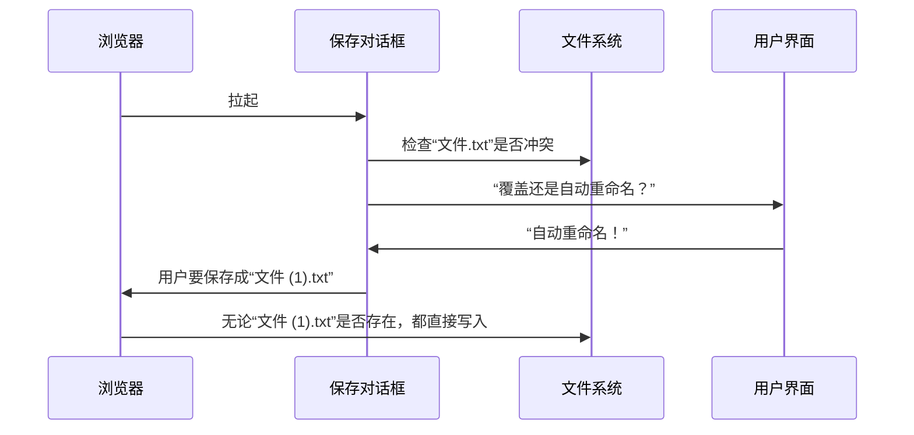

+++
date = '2026-10-29T13:54:05+08:00'
title = '我的 UI 不被定义'
description = "如果我的屏幕是圆的，六边形，三角形，我会被适配吗？"
# comment_id = "91e3b6ce78355bfc00274af0c5b101c4"
draft = true
+++

终于有人跳出来说 Linux 下的 UI 混乱的[问题](https://youtu.be/yobj13YpzkU)了，我也来提一嘴。

## 保存文件到底怎么你了

unix 哲学泛滥，没有人关心原子性问题。

我举个很简单的例子：你在在线编辑器保存一个 TXT 文件，你点击保存，但是保存对话框提示你文件已存在，你要覆盖吗？

但是这个覆盖吗，只是一个快照，它没法保证肯定会覆盖这个文件。

而，你要覆盖吗，也不是浏览器告诉你的结果，也不是网页告诉你的，或者浏览器根本不知道你在搞啥呢怎么还不保存文件。

万一，你点击覆盖的一瞬间，那个文件没了，反而我们创建了一个崭新的文件。

万一，你点击覆盖的一瞬间，那个文件被替换成另一个文件，我们覆盖了我们不应该覆盖的文件。

万一，你没有点击覆盖而是选择重命名，那个文件没了，你落得一个无意义的“文件 (1).txt”，但是浏览器没机会再问你一次“文件 (1).txt”也存在怎么办，显然换成“文件 (1)(1).txt”更脏。你犹豫半天就这样吧。

这个仍然是世界未解之谜，除非浏览器能提前锁定那个文件坑位。但是又有谁会这样做呢？或者让这个保存操作直接失败？

如果是你写 UI，你估计也会防御性的检查保存对话框给你的文件路径是不是已经有文件了，你也许定义了额外的行为。

我举个例子，[LocalSend](https://github.com/localsend/localsend) 接收文件时，它显示的是文件被发送过来的名字，而收到之后在内部**它悄悄地**重命名了文件来解决冲突，在 UI 层面实际保存到的位置藏在文件信息里，文件名和路径对不上。那怎么解决呢我也不知道，[等着吧](https://github.com/localsend/localsend/issues/2200)。

仍然改变不了这是未解之谜，每个开发者都可以自己定义这里的逻辑而没有统一的标准和规范。

## 怎么拉起文件选择器

我在写主站的时候，这个问题把我卡住了。

我认为[这个](https://stackoverflow.com/a/40971885)解决方案是 workaround，或者说 exploit，我很担心哪天这个窟窿被什么安全浏览器堵住了，它只是至今能用。

也许我在等的是 [File System Access](https://wicg.github.io/file-system-access/) API，我赶紧试了下，在 VSCode 内置浏览器工作了一半，在 Brave 浏览器完全不工作。

我不想把input做成[按钮](https://www.shadcn-svelte.com/docs/components/button)的形状... 因为我不想写一长串随时可能烂掉的css。

我只想等 File System Access 被多数浏览器使用。它有明确的类型定义，它不像很多 Event 我也不知道它什么类型，为什么啊。

## 在我的屏幕上不工作

如本文副标题，答案可以很开放，比如一个页面写100种布局。

我是不想写100种布局的，我只会问自己为什么组件在最坏的情况下会 overflow，为什么不能每行少放点东西，为什么不能藏起来。

我只能说多一个步骤就多两秒用户理解时间和两天设计师沉思，怎么把布局做到最优将是未来屏幕像性向那样不被定义的时候，就连屏幕都不再是异性恋(也就是弯的)的时候，最重要的议题。

最好，解决方案不是在 App 里面塞一个 LLM 人工智能布局。

我已经[沉思过了](https://github.com/sb-child/sb-child/blob/main/layouts/partials/post_meta.html#L23-L28)，最终我决定为了不让 meta span overflow，把更新日期和 hash 放在下一行。结果是高度增加了一行，没有 overflow，反正能用。
